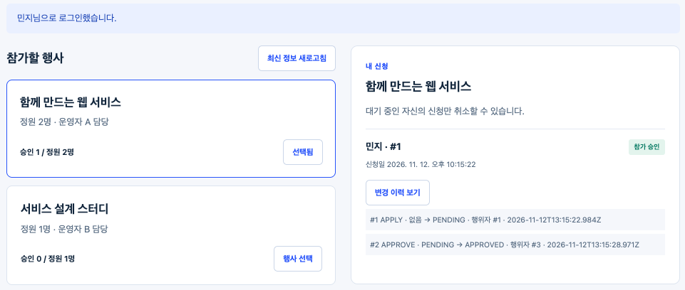
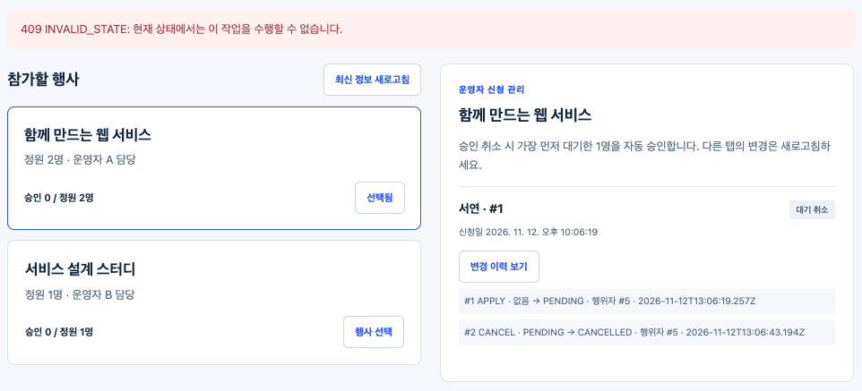
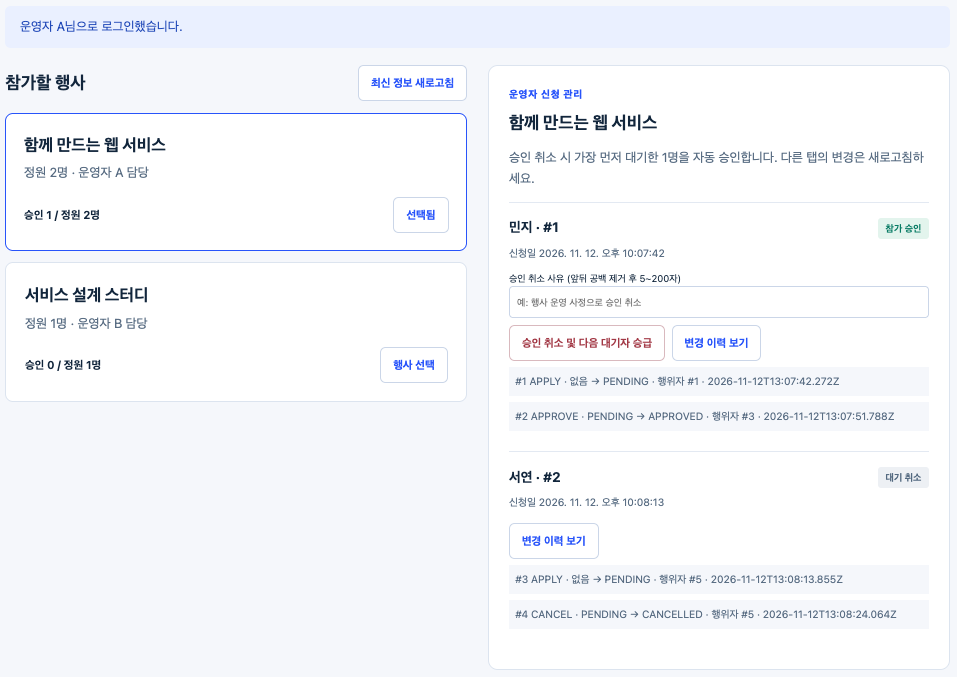
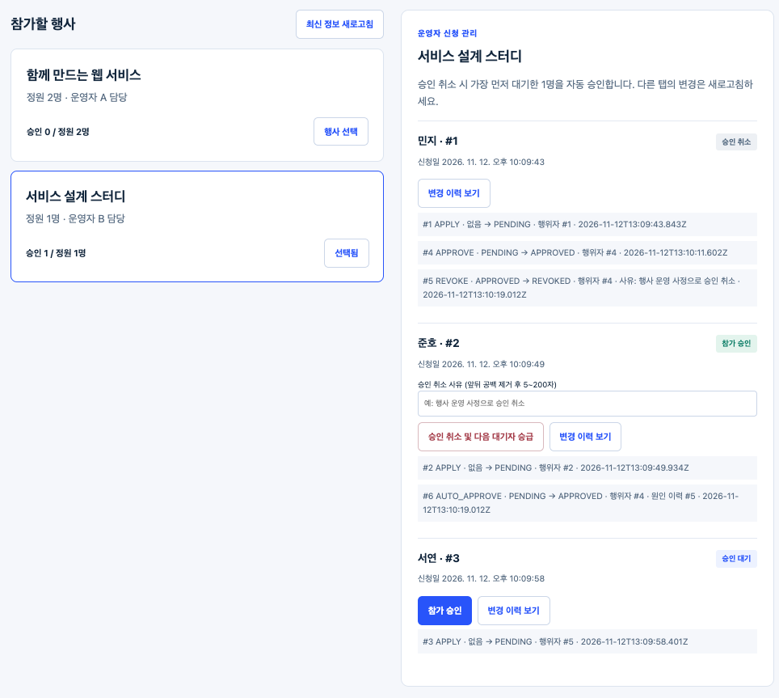
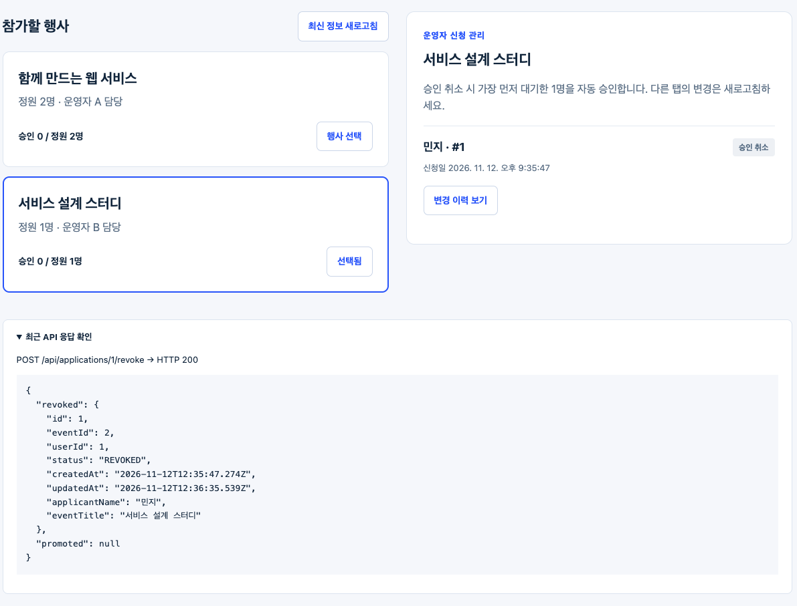

## 과제 02 

### 행사 신청·승인 서비스의 업무 규칙과 트랜잭션 구현
#### 과제 보고서: [보고서 PDF 보기](docs/report.pdf)

### 1. 프로젝트와 실행 방법

ApplyFlow는 행사 신청과 운영자 승인을 처리하는 웹서비스설계 과제 2 구현입니다. 학생은 행사에 신청하고 본인의 대기 신청을 취소할 수 있습니다. 담당 운영자는 신청을 승인하거나 사유를 입력해 승인을 취소합니다. 승인 취소로 자리가 나면 같은 행사에서 가장 먼저 대기한 신청 한 건을 자동 승인합니다. 상태 변경과 변경 이력은 SQLite 트랜잭션으로 함께 저장합니다.

Node.js **24.x**와 npm을 사용합니다. 별도 데이터베이스 서버는 필요하지 않습니다. 저장소를 복제한 뒤 저장소 루트에서 실행합니다.

```bash
node --version
npm ci
npm test
npm run test:assignment
npm run test:advanced
npm start
```

브라우저에서 <http://127.0.0.1:3000>을 엽니다. DB를 초기화하려면 서버를 종료한 뒤 아래 명령을 실행하고 `RESET`을 입력합니다. 신청과 변경 이력이 삭제됩니다.

```bash
npm run db:reset
```

연습 계정은 모두 `Classroom123!`을 사용합니다.

| 계정 | 역할 | 담당 |
| :--- | :--- | :--- |
| alice / bob / charlie | 학생 | 본인 신청·대기 취소 |
| manager1 | 운영자 A | 행사 1 · 정원 2명 |
| manager2 | 운영자 B | 행사 2 · 정원 1명 |

첫 실행 때 `data/app.sqlite`와 JWT 비밀 키가 생성됩니다. 이 파일과 `node_modules`는 제출 저장소에 포함하지 않습니다. `package-lock.json`은 포함하고, `.gitignore`에서 생성 데이터·비밀 파일·의존성 폴더를 제외합니다.

#### 1-1. 과제 요구사항별 구현 내용

| 요구사항 | 코드에 반영한 내용 | 검증 결과 |
| :--- | :--- | :--- |
| R1 신원·권한 | JWT에서 확인한 actor를 기준으로 학생, 신청자 본인, 행사 담당 운영자를 검사합니다. | T02, T07, T09, T14, T21, T27 통과 |
| R2 중복 신청 | 기존 신청을 검사하고 `UNIQUE(event_id,user_id)` 제약으로 저장 단계에서도 중복을 방지합니다. 제약 위반은 409로 처리합니다. | T04, T05 및 추가 두 서버 중복 신청 경쟁 10회 통과 |
| R3 상태 전이 | 신청·취소·직접 승인·승인 취소·자동 승급의 허용 전이만 처리하고 CANCELLED·REVOKED를 종료 상태로 둡니다. | T06, T08, T10~T12, T17, T22, T32 통과 |
| R4 정원 | APPROVED 신청만 세고 승인 직전에 정원을 다시 검사합니다. | T13과 두 서버 동시 승인 20회 통과 |
| R5 자동 승급 | 같은 행사 PENDING 신청을 `created_at ASC, id ASC`로 정렬해 첫 한 명만 승급합니다. | T17~T20, T32 및 추가 동시 승인 취소 경쟁 10회 통과 |
| R6 사유·이력 | 사유를 trim 후 5~200자로 검사합니다. 성공 이력에 행위자·전후 상태·시각을 기록하고 AUTO_APPROVE를 REVOKE 이력에 연결합니다. | T23~T25 통과 |
| R7 원자성 | 모든 상태 변경과 이력 저장에 SQLite `BEGIN IMMEDIATE`, `COMMIT`, `ROLLBACK`을 적용합니다. | T28~T30 오류 주입 롤백 통과 |
| R8 최신 상태 | 변경 요청의 상태·권한·정원 검사를 쓰기 트랜잭션 안에서 다시 수행합니다. | T10~T13, T22, T26, T32 통과 |

### 2. 과제 요구사항

아래 표는 구현 범위와 검증 증거를 요약합니다. 개별 테스트의 입력과 실제 결과는 [테스트 결과](docs/evidence/test-results.md)에 기록했습니다.

| 평가 항목 | 구현·확인할 내용 | 검증 요약 |
| :--- | :--- | :--- |
| **신원·중복·상태** | 로그인 actor 기반 권한, 사용자·행사별 단일 신청, 종료 상태 재변경 거부 | 인증·위조·다른 행사·반복 변경 테스트 통과 |
| **정원·자동 승급** | APPROVED만 정원에 포함, 승인 취소마다 FIFO 대기자 최대 한 명 승급 | 정원 초과·시각순·동률 ID순·대기자 없음 테스트 통과 |
| **사유·변경 이력** | reason 형식, 행위자·전후 상태·시각, causeHistoryId 연결 | 이력 조회와 원인 관계 테스트 통과 |
| **트랜잭션·동시성** | 상태와 이력을 단일 트랜잭션으로 저장하고 실패 시 전체 롤백 | APPLY·APPROVE·CANCEL·REVOKE·AUTO_APPROVE 실패 주입 및 두 서버 경쟁 검사 통과 |
| **화면·영속성** | 학생·운영자 화면, 오래된 화면 요청, 서버 재시작, 승급 결과 | U01~U05 화면 검증과 캡처 저장 |

#### 2-1. 신청·대기 취소

##### 구현 설명

- `POST /api/events/:id/applications`는 행사를 확인하고 로그인한 학생의 기존 신청 여부를 검사한 뒤 PENDING 신청과 APPLY 이력을 저장합니다. 성공 응답은 201과 Location 헤더를 반환합니다.
- `POST /api/applications/:id/cancel`은 신청자 본인의 PENDING 상태만 CANCELLED로 바꾸고 CANCEL 이력을 저장합니다. 대기 취소는 승인 자리를 비우지 않으므로 자동 승급을 실행하지 않습니다.
- 신청·취소 모두 상태 변경과 이력 저장을 같은 트랜잭션으로 처리합니다. 관련 구현은 `src/application-service.js`의 `apply()`와 `cancel()`입니다.

#### 2-2. 직접 승인과 정원

##### 구현 설명

- 담당 운영자만 해당 행사 신청을 승인할 수 있습니다. 다른 역할이나 다른 행사의 운영자는 403으로 거부합니다.
- 승인 대상은 매 요청마다 DB에서 다시 읽어 PENDING인지 확인합니다. 오래된 화면에서 이미 취소된 신청을 승인하려 하면 409 `INVALID_STATE`를 반환합니다.
- 승인 인원은 APPROVED 상태만 세며, 정원이 찬 경우 409 `CAPACITY_FULL`로 거부합니다. 승인 상태와 APPROVE 이력은 하나의 트랜잭션으로 저장합니다.
- 구현은 `src/application-service.js`의 `approve()`와 `src/repository.js`의 `approvedCount()`를 확인하세요.

#### 2-3. 승인 취소와 자동 승급

##### 구현 설명

- 승인 취소 본문은 `{"reason":"운영 사정으로 승인 취소"}` 형식입니다. 앞뒤 공백을 제거한 문자열 길이가 5~200자여야 하며 추가 필드는 허용하지 않습니다.
- 담당 운영자가 APPROVED 신청을 REVOKED로 바꾸고 REVOKE 이력을 저장합니다. 이어 같은 행사에서 PENDING 신청 한 건을 `created_at ASC, id ASC` 순서로 선택해 APPROVED로 승급합니다.
- 자동 승급 이력의 actorId는 승인 취소를 요청한 운영자 ID이고 `causeHistoryId`는 해당 REVOKE 이력 ID입니다. 대기자가 없으면 `promoted`는 null이며 승인 인원은 감소한 상태로 유지됩니다.
- 승인 취소·REVOKE 이력·대기자 선택·승급·AUTO_APPROVE 이력은 `src/application-service.js`의 `revoke()`에서 한 트랜잭션으로 처리합니다. 대기자 선택 SQL은 `src/repository.js`의 `nextPending()`입니다.

#### 2-4. 변경 이력과 롤백

##### 구현 설명

신청·대기 취소·직접 승인은 다음 구조로 동작합니다.

```text
BEGIN IMMEDIATE
  현재 상태와 권한 확인
  신청 상태 변경
  변경 이력 INSERT
COMMIT

오류 발생 → ROLLBACK
```

승인 취소와 자동 승급은 REVOKE와 AUTO_APPROVE를 포함한 전체 흐름을 하나의 트랜잭션으로 처리합니다. 상태 저장 또는 이력 INSERT 중 하나라도 실패하면 신청 상태와 이력 모두 요청 전 데이터로 돌아갑니다.

T28~T30은 테스트용 SQLite trigger로 APPLY, APPROVE, CANCEL, REVOKE, AUTO_APPROVE 이력 저장을 실패시켜 500 응답과 전체 롤백을 확인합니다. 세부 오류 주입 방법과 전후 상태는 [롤백 검증](docs/evidence/rollback-verification.md)에 기록했습니다.

#### 2-5. 테스트 및 화면 검증

##### 테스트 결과

Node.js v24.22.3에서 `npm ci` 후 다음 결과를 확인했습니다.

| 실행 항목 | 결과 | 확인 내용 |
| :--- | :--- | :--- |
| `npm test` | PASS 4 / 4 | 제공 기반 기능 |
| `npm run test:assignment` | PASS 32 / 32 | T01~T32 전체 |
| `npm run test:advanced` | PASS 1 / 1 | 두 서버 동시 승인 20회 |
| `node --test tests/concurrency-supplement.test.js` | PASS 1 / 1 | 중복 신청·동시 승인 취소 각 10회, DB 무결성 |
| `npm start` | 정상 시작 | health API 200, 화면 200 |

`TEST_INJECTED_FAILURE` 로그는 T28~T30이 롤백을 확인하기 위해 발생시킨 의도된 오류입니다. 추가 두 서버 경쟁 검사는 서로 다른 학생의 동시 신청, 동일 학생의 중복 신청, 동일 신청의 승인 취소 경합을 확인합니다.

##### 화면 검증 및 캡처

U01~U05는 임시 SQLite DB와 headless Chrome에서 실행했습니다. 각 흐름의 전체 캡처는 [screenshots](docs/evidence/screenshots/) 폴더에, 결과 설명은 [화면 검증 기록](docs/evidence/screen-verification.md)에 있습니다.

| ID | 확인한 흐름 | 결과 |
| :--- | :--- | :--- |
| U01 | 학생 신청 → 담당 운영자 승인 → 승인 상태와 승인 인원 확인 | PASS |
| U02 | 학생 대기 취소 후 오래된 운영자 화면에서 승인 요청 | 409 거부, CANCELLED 유지 · PASS |
| U03 | 동일 DB로 서버 종료·재실행 후 신청 상태와 이력 확인 | PASS |
| U04 | 행사 2에서 세 학생 신청 → Alice 승인 취소 → Bob 승급·Charlie 대기 및 원인 이력 확인 | PASS |
| U05 | 대기자 없는 승인 취소 → REVOKED, 승인 인원 0, `promoted=null` 확인 | PASS |

##### 화면 캡처

화면별 검증 내용이 잘 보이도록 데스크톱 가로 화면에서 캡처했습니다. 캡처마다 화면 구성과 이미지 크기는 다를 수 있으며, 이미지를 누르면 원본 크기로 확인할 수 있습니다.

**U01 · 학생 신청과 담당 운영자 승인**



**U02 · 취소된 신청에 대한 오래된 화면의 승인 요청 거부**



**U03 · 서버 재시작 후 상태와 이력 유지**



**U04 · FIFO 자동 승급과 원인 이력 연결**



**U05 · 대기자 없는 승인 취소**



### 3. 트랜잭션과 동시성 개념

#### 3-1. 단일 상태 변경 트랜잭션

`BEGIN IMMEDIATE`는 현재 상태와 정원을 읽고 바꾸는 동안 SQLite 쓰기 잠금을 확보합니다. 이를 통해 경쟁 요청이 이전 상태를 동시에 기준으로 변경하지 못하게 합니다. APPLY·CANCEL·APPROVE는 상태 변경과 해당 이력 한 건을 COMMIT 전에 함께 저장합니다.

#### 3-2. 승인 취소 트랜잭션

승인 취소는 REVOKED 변경과 REVOKE 이력만 먼저 COMMIT하지 않습니다. 정렬된 대기자 선택, 승급 상태 변경, AUTO_APPROVE 이력 저장이 모두 성공한 뒤 한 번에 COMMIT합니다. 중간 단계가 실패하면 전체 ROLLBACK합니다. 순서도와 SQL 근거는 [과제 보고서](docs/report.pdf)에 정리했습니다.

#### 3-3. 정원과 동시성

APPROVED 신청만 정원에 포함합니다. 직접 승인 트랜잭션 안에서 승인 수를 확인하므로 두 서버가 마지막 한 자리를 동시에 승인해도 한 요청만 성공합니다. 승인 취소 경쟁에서도 같은 신청의 첫 요청만 성공하고 대기자는 한 번만 승급합니다. 반복 검사는 해당 시나리오의 검증 증거이며 모든 실행 환경의 경쟁 부재를 증명하지는 않습니다.

#### 3-4. 영속성과 변경 이력

신청 및 이력은 SQLite 파일에 저장됩니다. 서버를 재실행해도 데이터가 유지됩니다. `application_history`에는 신청 ID, 행위자, 행위, 변경 전·후 상태, 시각, reason, 원인 이력 ID를 기록합니다. DB 검증 쿼리와 결과는 [DB 검증 기록](docs/evidence/database-verification.md)에 있습니다.

### 4. 검증 범위와 AI 활용

- 검증은 Node.js v24.22.3에서 수행했습니다. 테스트와 화면 검증은 임시 DB를 사용했고 저장소의 기본 DB는 변경하지 않았습니다.
- **AI 활용:** Codex를 사용해 `application-service.js`의 `apply`, `cancel`, `approve`, `revoke`와 트랜잭션 처리, `repository.js`의 대기열 조회를 구현했습니다. README·검증 시나리오·보고서 초안 작성에도 AI를 활용했습니다.
- 기반·필수·심화 테스트, 추가 두 서버 경쟁 검사, U01~U05 화면 흐름을 실행하고 결과를 증거 파일로 남겼습니다. 테스트 명령과 화면 검증 결과는 이 README와 증거 문서에 정리했습니다.
